# Hi, I'm Hanzala Saqib 👋

### Full Stack AI Developer · LLM Agents · RAG · React · Node.js · Python · IoT

I build production-ready products that put AI to work: tool-calling LLM agents, RAG systems, AI-powered and 3D e-commerce, and real-time dashboards for embedded systems.

📍 Lahore, Pakistan · 🌍 Open to remote and international roles

---

## 🧑‍💻 About me

- 🤖 I build **AI products end to end**: tool-calling agents with streaming (SSE), RAG with citations, guardrails and a deterministic fallback when no LLM key is set
- 🧱 **Full stack**: React 19 + TypeScript on the front end; Node.js 22, Express 5, tRPC and FastAPI on the back end; WebSockets; PostgreSQL, MySQL, SQLite, SQLAlchemy and Drizzle ORM
- 🎨 **Design to code**: Figma-ready design tokens (W3C format), design systems with light and dark themes, accessible and responsive UI
- 🧊 **3D on the web**: real-time product viewers on a hand-written WebGL2 renderer (GLSL shaders for metal, gems and fabric) as well as Three.js and React Three Fiber
- 🛡️ **Domain work**: cybersecurity (MITRE ATT&CK, Sigma, log forensics), IoT and embedded systems (ESP32, MQTT, anomaly detection) and commerce (search, recommendations, analytics)
- ✅ **Engineering habits**: automated tests (Pytest, Vitest, node:test), GitHub Actions CI, Docker Compose, JWT auth with RBAC, rate limiting and live demos for featured projects

## 🚀 Featured projects

Every featured project has a **live demo** you can try in the browser; the full-stack ones also ship a backend you can run with Docker.

<table>
<tr>
<td width="50%" valign="top">

### 💍 [Zewar](https://github.com/hanzalasqb/zewar-jewellery)
A fine-jewellery store in **real-time 3D**. Choose 18k gold or platinum, swap a diamond for an emerald or sapphire, and the ring, price and stock change together. **Custom WebGL2 renderer** (studio-lit metals, refracting gems, pearl lustre), COD checkout, coupons and an admin order workflow on a Node.js API.

`React 19` `TypeScript` `WebGL2 · GLSL` `Node.js 22` `SQLite` `Zod` `Figma tokens`

**[▶ Live demo](https://hanzalasqb.github.io/zewar-jewellery/)** · **[Code](https://github.com/hanzalasqb/zewar-jewellery)**

</td>
<td width="50%" valign="top">

### 👕 [Qaba](https://github.com/hanzalasqb/qaba-streetwear)
A streetwear and eastern-wear store with **3D garments** you can spin and recolour: tees, hoodies, a bomber, kurtas and joggers inflated from 2D patterns with fabric sheen, prints and stitching. Colour and size variants with live stock, cart, checkout, order tracking and admin.

`React 19` `TypeScript` `WebGL2 · GLSL` `Node.js 22` `SQLite` `Zod` `Figma tokens`

**[▶ Live demo](https://hanzalasqb.github.io/qaba-streetwear/)** · **[Code](https://github.com/hanzalasqb/qaba-streetwear)**

</td>
</tr>
<tr>
<td width="50%" valign="top">

### 🪐 [Orbit](https://github.com/hanzalasqb/orbit-pm)
Real-time project management for product teams: **Kanban drag and drop**, live sync and presence over **WebSockets**, a ⌘K command palette, optimistic updates and team insights. Monorepo with one set of **Zod** schemas shared by the React app and the Node.js API.

`React 19` `TypeScript` `Node.js 22` `WebSockets` `Zod` `SQLite` `Figma tokens`

**[▶ Live demo](https://hanzalasqb.github.io/orbit-pm/)** · **[Code](https://github.com/hanzalasqb/orbit-pm)**

</td>
<td width="50%" valign="top">

### 📒 [Ledgerly](https://github.com/hanzalasqb/ledgerly)
Invoicing and cash flow for freelancers and studios: an invoice editor with a **live A4 preview**, partial payments, overdue tracking, **multi-currency** reporting and a **d3** cash-flow dashboard, with exact integer money math shared by the UI and the Node.js API.

`React 19` `TypeScript` `d3` `Node.js 22` `Zod` `SQLite` `Figma tokens`

**[▶ Live demo](https://hanzalasqb.github.io/ledgerly/)** · **[Code](https://github.com/hanzalasqb/ledgerly)**

</td>
</tr>
<tr>
<td width="50%" valign="top">

### 🛡️ [ShieldMind AI](https://github.com/hanzalasqb/shieldmind-ai)
AI copilot for SOC analysts. A tool-calling LLM agent triages logs, maps findings to **MITRE ATT&CK**, looks up CVEs, writes **Sigma** detection rules and builds incident-response playbooks.

`FastAPI` `Python` `React` `TypeScript` `SQLAlchemy` `LLM agents`

**[▶ Live demo](https://hanzalasqb.github.io/shieldmind-ai/)** · **[Code](https://github.com/hanzalasqb/shieldmind-ai)**

</td>
<td width="50%" valign="top">

### 🛍️ [ShopSense AI](https://github.com/hanzalasqb/shopsense-ai)
AI-powered e-commerce platform: natural-language search, a shopping assistant that adds to cart, AI review summaries, recommendations and an admin dashboard with an AI copywriter.

`React` `Node.js` `Express` `PostgreSQL` `Drizzle` `TypeScript`

**[▶ Live demo](https://hanzalasqb.github.io/shopsense-ai/)** · **[Code](https://github.com/hanzalasqb/shopsense-ai)**

</td>
</tr>
<tr>
<td width="50%" valign="top">

### 🔥 [Ember & Saffron](https://github.com/hanzalasqb/ember-saffron-restaurant)
AI restaurant platform: allergen-aware menu and online ordering, live table reservations, a real-time kitchen display, an AI concierge and menu-engineering insights.

`React` `Node.js` `Express` `PostgreSQL` `SSE` `TypeScript`

**[▶ Live demo](https://hanzalasqb.github.io/ember-saffron-restaurant/)** · **[Code](https://github.com/hanzalasqb/ember-saffron-restaurant)**

</td>
<td width="50%" valign="top">

### 📡 [EdgePulse IoT AI](https://github.com/hanzalasqb/edgepulse-iot-ai)
AI monitoring for embedded systems: ESP32 firmware streams sensor data over MQTT, the backend detects anomalies and forecasts failures, and an AI assistant diagnoses faults on a live dashboard.

`ESP32` `MQTT` `FastAPI` `WebSockets` `React` `Machine learning`

**[▶ Live demo](https://hanzalasqb.github.io/edgepulse-iot-ai/)** · **[Code](https://github.com/hanzalasqb/edgepulse-iot-ai)**

</td>
</tr>
<tr>
<td width="50%" valign="top">

### 📚 [DocuMind AI](https://github.com/hanzalasqb/documind-ai)
RAG "chat with your documents" app: smart chunking, retrieval with per-document filters and answers with numbered **citations**, streamed token by token over SSE. Works with OpenAI or fully local with **Ollama**.

`FastAPI` `Python` `React` `TypeScript` `Embeddings` `Docker`

**[▶ Live demo](https://hanzalasqb.github.io/documind-ai/)** · **[Code](https://github.com/hanzalasqb/documind-ai)**

</td>
<td width="50%" valign="top">

### 🎯 [AI Resume Analyzer](https://github.com/hanzalasqb/ai-resume-analyzer)
Matches a resume against a job description: **hybrid scoring** (LLM 70% + deterministic keywords 30%), skill gaps, concrete resume fixes and tailored interview questions, with Zod-validated JSON output.

`Node.js` `Express` `TypeScript` `React` `Zod` `Docker`

**[▶ Live demo](https://hanzalasqb.github.io/ai-resume-analyzer/)** · **[Code](https://github.com/hanzalasqb/ai-resume-analyzer)**

</td>
</tr>
<tr>
<td colspan="2" valign="top">

### ✨ [3D Developer Portfolio](https://github.com/hanzalasqb/hanzalasqb.github.io)
My portfolio site: a real-time **Three.js** hero scene, 3D tilt cards, scroll-driven motion and every project with its demo and source. Lazy-loads the 3D scene and respects reduced-motion settings.

`React 19` `Three.js` `React Three Fiber` `Motion` `Tailwind CSS`

**[▶ Live site](https://hanzalasqb.github.io/)** · **[Code](https://github.com/hanzalasqb/hanzalasqb.github.io)**

</td>
</tr>
</table>

## 🗂️ All projects

> 21 public projects grouped by area. ▶ = live demo in the browser.

### 🤖 AI & LLM

| Project | What it does | Stack | Links |
|---------|--------------|-------|-------|
| 🛡️ **[ShieldMind AI](https://github.com/hanzalasqb/shieldmind-ai)** | SOC copilot: tool-calling agent for log triage, IOC extraction, CVE intel (NVD), MITRE ATT&CK mapping, Sigma rules and IR playbooks | FastAPI · React · TypeScript · PostgreSQL · Docker | [▶ Demo](https://hanzalasqb.github.io/shieldmind-ai/) · [Code](https://github.com/hanzalasqb/shieldmind-ai) |
| 🧠 **[CyberMind AI](https://github.com/hanzalasqb/CyberMind-AI)** | Free, private, self-hosted security assistant: multi-model routing with automatic failover, RAG over files, live CVE data, a security toolkit and image / video generation | Python · FastAPI · Gemini · Groq · Ollama | [Code](https://github.com/hanzalasqb/CyberMind-AI) |
| 🤖 **[AI Engineering Copilot](https://github.com/hanzalasqb/ai-engineering-copilot)** | AI workspace for engineers: multi-model streaming chat, persistent memory, knowledge base, file intelligence (PDF / DOCX / XLSX) and a Monaco code editor | React · TypeScript · tRPC · Drizzle · MySQL · S3 | [Code](https://github.com/hanzalasqb/ai-engineering-copilot) |
| 📚 **[DocuMind AI](https://github.com/hanzalasqb/documind-ai)** | RAG "chat with your documents" app with cited answers streamed over SSE; works with OpenAI or local Ollama | FastAPI · Python · React · Embeddings · Docker | [▶ Demo](https://hanzalasqb.github.io/documind-ai/) · [Code](https://github.com/hanzalasqb/documind-ai) |
| 🎯 **[AI Resume Analyzer](https://github.com/hanzalasqb/ai-resume-analyzer)** | Resume vs job-description matcher: hybrid AI + keyword fit score, skill gaps, resume fixes and interview questions | Node.js · Express · TypeScript · Zod · React · Docker | [▶ Demo](https://hanzalasqb.github.io/ai-resume-analyzer/) · [Code](https://github.com/hanzalasqb/ai-resume-analyzer) |
| 🌌 **[HS Space](https://github.com/hanzalasqb/hs-space)** | Multi-model AI platform (GPT-4o, Claude, Gemini) with RBAC, admin approval workflow, projects, S3 attachments and usage analytics | React · TypeScript · tRPC · MySQL · S3 | [Code](https://github.com/hanzalasqb/hs-space) |
| 📰 **[Fake News Detector](https://github.com/hanzalasqb/fake-news-detection-system)** | Classifies news as REAL or FAKE from text, URLs or RSS feeds, with confidence scores and history | Python · FastAPI · React · ML | [Code](https://github.com/hanzalasqb/fake-news-detection-system) |

### 🛍️ Full-stack & e-commerce

| Project | What it does | Stack | Links |
|---------|--------------|-------|-------|
| 💍 **[Zewar](https://github.com/hanzalasqb/zewar-jewellery)** | Fine-jewellery store in real-time 3D: metal, stone and size variants with live price and stock, custom WebGL2 renderer, COD checkout, coupons and admin order workflow | React 19 · TypeScript · WebGL2 · Node.js 22 · SQLite | [▶ Demo](https://hanzalasqb.github.io/zewar-jewellery/) · [Code](https://github.com/hanzalasqb/zewar-jewellery) |
| 👕 **[Qaba](https://github.com/hanzalasqb/qaba-streetwear)** | Streetwear store with 3D garments you can spin and recolour, colour and size variants, cart, checkout, order tracking and admin dashboard | React 19 · TypeScript · WebGL2 · Node.js 22 · SQLite | [▶ Demo](https://hanzalasqb.github.io/qaba-streetwear/) · [Code](https://github.com/hanzalasqb/qaba-streetwear) |
| 🪐 **[Orbit](https://github.com/hanzalasqb/orbit-pm)** | Real-time project management: Kanban drag and drop, WebSocket sync and presence, command palette, insights, RBAC | React 19 · TypeScript · Node.js 22 · WebSockets · Zod | [▶ Demo](https://hanzalasqb.github.io/orbit-pm/) · [Code](https://github.com/hanzalasqb/orbit-pm) |
| 📒 **[Ledgerly](https://github.com/hanzalasqb/ledgerly)** | Invoicing SaaS: live invoice preview, partial payments, overdue tracking, multi-currency d3 cash-flow dashboard | React 19 · TypeScript · d3 · Node.js 22 · Zod | [▶ Demo](https://hanzalasqb.github.io/ledgerly/) · [Code](https://github.com/hanzalasqb/ledgerly) |
| 🛍️ **[ShopSense AI](https://github.com/hanzalasqb/shopsense-ai)** | AI e-commerce: natural-language search, shopping assistant that adds to cart, AI review summaries, recommendations and admin analytics | React · Node.js · Express · PostgreSQL · Drizzle | [▶ Demo](https://hanzalasqb.github.io/shopsense-ai/) · [Code](https://github.com/hanzalasqb/shopsense-ai) |
| 🔥 **[Ember & Saffron](https://github.com/hanzalasqb/ember-saffron-restaurant)** | AI restaurant platform: allergen-aware ordering with live tracking, table reservations, real-time kitchen display and an AI concierge | React · Node.js · PostgreSQL · SSE | [▶ Demo](https://hanzalasqb.github.io/ember-saffron-restaurant/) · [Code](https://github.com/hanzalasqb/ember-saffron-restaurant) |
| 💎 **[By Salma](https://github.com/hanzalasqb/by-salma)** | Jewellery store: cinematic storefront, cart, COD checkout, coupons, shipping rules and role-based admin panel | React · tRPC · Drizzle · MySQL · S3 | [Code](https://github.com/hanzalasqb/by-salma) |
| 🧪 **[Zyvenox Lab](https://github.com/hanzalasqb/zyvenoxNew)** | Studio platform: 3D marketing site, AI service navigator, cost estimator, secure client portal and admin back-office on AWS EC2 + RDS | React · tRPC · Drizzle · MySQL · AWS · Nginx | [Code](https://github.com/hanzalasqb/zyvenoxNew) |

### 📡 IoT & embedded

| Project | What it does | Stack | Links |
|---------|--------------|-------|-------|
| 📡 **[EdgePulse IoT AI](https://github.com/hanzalasqb/edgepulse-iot-ai)** | ESP32 + MQTT telemetry, real-time WebSocket dashboard, anomaly detection (z-score, Isolation Forest), predictive maintenance and an LLM assistant | ESP32 · MQTT · FastAPI · React · ML | [▶ Demo](https://hanzalasqb.github.io/edgepulse-iot-ai/) · [Code](https://github.com/hanzalasqb/edgepulse-iot-ai) |
| 🏠 **[Smart Home Dashboard](https://github.com/hanzalasqb/smart-home-dashboard)** | ESP32 control panel: temperature, humidity and motion sensing, light / fan relays, servo door lock and security mode | ESP32 · C++ · Node.js · Express · JavaScript | [Code](https://github.com/hanzalasqb/smart-home-dashboard) |

### 🌐 Web, portfolio & CMS

| Project | What it does | Stack | Links |
|---------|--------------|-------|-------|
| ✨ **[3D Developer Portfolio](https://github.com/hanzalasqb/hanzalasqb.github.io)** | My portfolio: real-time Three.js hero, 3D tilt cards, scroll-driven motion and every project with demos | React 19 · Three.js · R3F · Motion · Tailwind | [▶ Live](https://hanzalasqb.github.io/) · [Code](https://github.com/hanzalasqb/hanzalasqb.github.io) |
| 🌑 **[Signal Noir Portfolio](https://github.com/hanzalasqb/hanzala-saqib-portfolio)** | Earlier cinematic portfolio with an interactive puzzle headshot, case-study modals and skill filters | React · TypeScript · Vite · Tailwind | [▶ Live](https://hanzalasqb.github.io/hanzala-saqib-portfolio/) · [Code](https://github.com/hanzalasqb/hanzala-saqib-portfolio) |
| 🗂️ **[Portfolio CMS](https://github.com/hanzalasqb/hanzala-portfolio-cms)** | Self-hosted portfolio with an admin dashboard to edit every section and upload media; JSON storage, PM2 + Nginx on EC2 | Node.js · Express · EJS · AWS EC2 | [Code](https://github.com/hanzalasqb/hanzala-portfolio-cms) |
| 📬 **[Accessible Contact Form](https://github.com/hanzalasqb/pull-req)** | Responsive contact form with inline, screen-reader-friendly validation and automatic dark mode | HTML · CSS · JavaScript | [Code](https://github.com/hanzalasqb/pull-req) |

## 🛠️ Tech stack

**AI / LLM**

-7C3AED)

**Frontend**

**Backend**

**Databases**

**IoT / Embedded**

**Security**

**DevOps / Testing**

## 📈 Currently

- 🔭 Building AI agents that act inside real products, with tests and guardrails
- 🌱 Learning system design, vector databases (pgvector, Qdrant) and LLM evaluation
- 🤝 Open to **Full Stack / AI Engineer** roles and freelance projects

## 📊 GitHub at a glance

<picture>
  <source media="(prefers-color-scheme: dark)" srcset="https://raw.githubusercontent.com/hanzalasqb/hanzalasqb/main/assets/overview-dark.svg" />
  
</picture>
<picture>
  <source media="(prefers-color-scheme: dark)" srcset="https://raw.githubusercontent.com/hanzalasqb/hanzalasqb/main/assets/languages-dark.svg" />
  
</picture>

---

<picture>
  <source media="(prefers-color-scheme: dark)" srcset="https://raw.githubusercontent.com/hanzalasqb/hanzalasqb/main/assets/footer-dark.svg" />
  
</picture>

