# Hi, I'm Hanzala Saqib 👋

### Full Stack AI Developer · LLM Agents · RAG · React · Node.js · Python · IoT

I build production-ready products that put AI to work: tool-calling LLM agents, RAG systems, AI-powered e-commerce and real-time dashboards for embedded systems.

📍 Lahore, Pakistan · 🌍 Open to remote and international roles

---

## 🧑‍💻 About me

- 🤖 I build **AI products end to end**: tool-calling agents with streaming (SSE), RAG with citations, guardrails and a deterministic fallback when no LLM key is set
- 🧱 **Full stack**: React 19 + TypeScript on the front end; FastAPI, Express 5 and tRPC on the back end; PostgreSQL, MySQL, SQLAlchemy and Drizzle ORM
- 🛡️ **Domain work**: cybersecurity (MITRE ATT&CK, Sigma, log forensics), IoT and embedded systems (ESP32, MQTT, anomaly detection) and commerce (search, recommendations, analytics)
- ✅ **Engineering habits**: automated tests (Pytest, Vitest), GitHub Actions CI, Docker Compose, JWT auth with RBAC, rate limiting and live demos for every project

## 🚀 Featured projects

Each featured project has a **live demo** that runs entirely in your browser, plus a full backend you can run with Docker.

<table>
<tr>
<td width="50%" valign="top">

### 🛡️ [ShieldMind AI](https://github.com/hanzalasqb/shieldmind-ai)
AI copilot for SOC analysts. A tool-calling LLM agent triages logs, maps findings to **MITRE ATT&CK**, looks up CVEs, writes **Sigma** detection rules and builds incident-response playbooks.

`FastAPI` `Python` `React` `TypeScript` `SQLAlchemy` `LLM agents`

**[▶ Live demo](https://hanzalasqb.github.io/shieldmind-ai/)** · **[Code](https://github.com/hanzalasqb/shieldmind-ai)**

</td>
<td width="50%" valign="top">

### 🛍️ [ShopSense AI](https://github.com/hanzalasqb/shopsense-ai)
AI-powered e-commerce platform: natural-language search, a shopping assistant that adds to cart, AI review summaries, recommendations and an admin dashboard with an AI copywriter.

`React` `Node.js` `Express` `PostgreSQL` `Drizzle` `TypeScript`

**[▶ Live demo](https://hanzalasqb.github.io/shopsense-ai/)** · **[Code](https://github.com/hanzalasqb/shopsense-ai)**

</td>
</tr>
<tr>
<td width="50%" valign="top">

### 🔥 [Ember & Saffron](https://github.com/hanzalasqb/ember-saffron-restaurant)
AI restaurant platform: allergen-aware menu and online ordering, live table reservations, a real-time kitchen display, an AI concierge and menu-engineering insights.

`React` `Node.js` `Express` `PostgreSQL` `SSE` `TypeScript`

**[▶ Live demo](https://hanzalasqb.github.io/ember-saffron-restaurant/)** · **[Code](https://github.com/hanzalasqb/ember-saffron-restaurant)**

</td>
<td width="50%" valign="top">

### 📡 [EdgePulse IoT AI](https://github.com/hanzalasqb/edgepulse-iot-ai)
AI monitoring for embedded systems: ESP32 firmware streams sensor data over MQTT, the backend detects anomalies and forecasts failures, and an AI assistant diagnoses faults on a live dashboard.

`ESP32` `MQTT` `FastAPI` `WebSockets` `React` `Machine learning`

**[▶ Live demo](https://hanzalasqb.github.io/edgepulse-iot-ai/)** · **[Code](https://github.com/hanzalasqb/edgepulse-iot-ai)**

</td>
</tr>
</table>

### More AI projects

| Project | What it does | Stack |
|---------|--------------|-------|
| 🤖 **[AI Engineering Copilot](https://github.com/hanzalasqb/ai-engineering-copilot)** | AI workspace for engineers: multi-model streaming chat, persistent memory, knowledge base, file intelligence and a Monaco code editor | React · TypeScript · tRPC · Drizzle · MySQL · S3 |
| 📚 **[DocuMind AI](https://github.com/hanzalasqb/documind-ai)** | RAG app for chatting with your documents, with cited answers streamed over SSE; works with OpenAI or local Ollama | FastAPI · Python · React · Embeddings · Docker |
| 🎯 **[AI Resume Analyzer](https://github.com/hanzalasqb/ai-resume-analyzer)** | Compares a resume with a job description: hybrid AI + keyword fit score, skill gaps and interview questions | Node.js · Express · TypeScript · Zod · React |
| 🌌 **[HS Space](https://github.com/hanzalasqb/hs-space)** | Multi-model AI platform (GPT-4o, Claude, Gemini) with RBAC, an admin approval workflow and usage analytics | React · TypeScript · tRPC · MySQL · S3 |
| 💎 **[By Salma](https://github.com/hanzalasqb/by-salma)** | Full-stack e-commerce store: storefront, cart, COD checkout, coupons and a role-based admin panel | React · Node.js · tRPC · Drizzle · MySQL |

## 🛠️ Tech stack

**AI / LLM**

-7C3AED)

**Frontend**

**Backend**

**Databases**

**IoT / Embedded**

**Security**

**DevOps / Testing**

## 📈 Currently

- 🔭 Building AI agents that act inside real products, with tests and guardrails
- 🌱 Learning system design, vector databases (pgvector, Qdrant) and LLM evaluation
- 🤝 Open to **Full Stack / AI Engineer** roles and freelance projects

## 📊 GitHub at a glance

<picture>
  <source media="(prefers-color-scheme: dark)" srcset="https://raw.githubusercontent.com/hanzalasqb/hanzalasqb/main/assets/overview-dark.svg" />
  
</picture>
<picture>
  <source media="(prefers-color-scheme: dark)" srcset="https://raw.githubusercontent.com/hanzalasqb/hanzalasqb/main/assets/languages-dark.svg" />
  
</picture>

---

<picture>
  <source media="(prefers-color-scheme: dark)" srcset="https://raw.githubusercontent.com/hanzalasqb/hanzalasqb/main/assets/footer-dark.svg" />
  
</picture>

